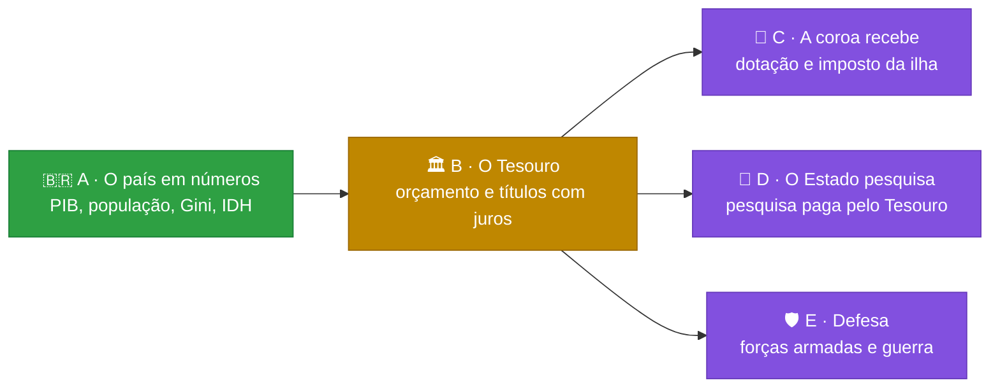

# 🎲 Trajetória

[](https://github.com/Lhordriyon/Calculadora-Viva/actions/workflows/ci.yml)
[](https://github.com/Lhordriyon/Calculadora-Viva/actions/workflows/android.yml)


## 📱 [Baixar o app para Android (APK)](https://github.com/Lhordriyon/Calculadora-Viva/releases/download/android/Trajetoria.apk)

## 🌐 [Jogar no navegador](https://lhordriyon.github.io/Calculadora-Viva/)

**Instalar no Android:** toque no link acima pelo celular, abra o arquivo `Trajetoria.apk` quando o download terminar e confirme. Se o Android pedir, permita que o navegador instale apps ("fontes desconhecidas"). Para atualizar, baixe de novo e instale por cima: a vida salva continua. O APK é gerado de novo a cada atualização do jogo ([página da versão](https://github.com/Lhordriyon/Calculadora-Viva/releases/tag/android)).

---

## 🆕 Novidades: Correção C1 · A história de volta ao centro (20/10/2026)

<p align="center">
  
  &nbsp;
  
</p>

> [!IMPORTANT]
> **O que aconteceu:** a cara nova (V1) foi medida num celular comum, com a letra normal. No celular do dono, com a letra do sistema maior, os cartões do cabeçalho tomavam a tela, a história ficava com um quarto dela (e com 11 px durante um evento), o dinheiro saía cortado e o botão dourado fazia passar o ano sem as escolhas. Esta correção mediu tudo de novo, em sete tamanhos de tela e letra, nos dois temas. O tema noite e ouro ficou.

> [!TIP]
> **Para testar:** jogue com a letra do celular do jeito que você usa. Confira que a história do ano aparece do começo depois de "Viver mais 1 ano", que o dinheiro aparece inteiro, que o botão diz quantas escolhas sobram e que, num evento, as opções ficam sempre à vista. Abra uma folha (Família, Carreira, Dinheiro) e feche pelo **X** no topo ou pelo voltar do Android. Se puder, mande uma captura da tela principal: ela confirma o tamanho da letra do seu celular.

| ✅ O que esta correção trouxe | ⏳ O que ela ainda não trouxe |
|---|---|
| 📖 **A história no centro:** o cabeçalho virou uma faixa de texto (o nome, a idade, a economia, os indicadores e o dinheiro), sem cartões nem retrato | ✍️ **Correção C2**, o texto que contradiz a vida: pessoas que já morreram falando, irmãos trocados, concordância ("tioa") |
| 💰 **Nenhum número cortado:** o dinheiro quebra linha em vez de virar "R$ 2,9…" | ⚙️ **Correção C3**, regras que se medem errado: a régua do dinheiro, os falsos dilemas, os mandatos sem fim |
| ⏩ **O botão do ano diz quantas escolhas sobram** ("Viver mais 1 ano · sobram 3") e só fica dourado quando não há o que escolher | 📱 O ícone novo no app Android instalado |
| 👆 **O toque duplo não passa mais o ano:** depois de um evento, o segundo toque é ignorado (passava o ano 12 vezes em 40) | 🍩 A rosca do patrimônio na folha Dinheiro |
| 🎴 **No evento, as opções ficam sempre à vista**; o texto longo rola por dentro, e a história guarda três linhas | |
| 📜 **A rolagem mostra o começo do ano**, não o fim; o balanço do ano virou uma linha pequena | |
| ❌ **As folhas fecham no topo** (o X) e com o **voltar do Android**, que antes fechava o app | |
| 👨‍👩‍👧 **Família** com os medidores certos de novo; **Carreira** com o Poder primeiro para quem tem cargo e as profissões fechadas numa linha só, com o motivo | |
| 🌙 **O ouro só onde tem papel:** o marco da trajetória, o ponto de novidade, o fio do evento; a Felicidade virou laranja para não se confundir com ele | |
| 🔠 **Um arranjo só** para qualquer tamanho de letra: o que precisa ceder quebra linha, sem trocar a tela de repente | |

**Medido no navegador**, no tamanho do celular do dono (360 × 780), com o save de uma vida cheia:

| Letra do sistema | História (linha do tempo) antes | Agora |
|---|---|---|
| 🔤 Normal (1,0) | 224 px · 29% da tela | 334 px · 43% |
| 🔤 Um pouco maior (1,15) | 168 px · 22% | 320 px · 41% |
| 🔠 Grande (1,45, a do dono) | 186 px · 24% | 234 px · 30% |
| 🎴 Grande, com um evento na tela | 11 px | 107 px |

Nenhuma rolagem para o lado, nenhum alvo de toque abaixo de 44 px, nenhuma letra abaixo de 12 px e nenhum erro no console, nos dois temas. O motor não mudou: o túnel de vento dá as mesmas vidas. O histórico de atualizações está no [📜 CHANGELOG](CHANGELOG.md).

## 🗺️ Os próximos blocos

Pedidos do dono em 19/10, em blocos pequenos, na ordem em que um precisa do outro. A cara nova (V1) e a correção dela (C1 a C3) entraram no meio, a pedido dele:



| Bloco | O que entra | Por que nesta ordem |
|---|---|---|
| 🟢 **A** · O país em números | PIB, população, PIB per capita, Gini, IDH | ✅ feito |
| 🟡 **B** · O Tesouro | o orçamento do governo em reais; comprar títulos que pagam cupom na conta ou no caixa da empresa | quem paga a coroa, a pesquisa e o exército é o Tesouro |
| 🟣 **C** · A coroa recebe | dotação da Casa Real que sai do Tesouro; a ilha soberana com população, PIB e imposto | precisa do Tesouro (B) e do país em números (A) |
| 🟣 **D** · O Estado pesquisa | quem governa decide quanto do orçamento vai para P&D; a pesquisa vira cura, satélite, patente | precisa do orçamento (B) |
| 🟣 **E** · Defesa | forças armadas com custo e capacidade; guerra como processo, com custos e consequências | precisa do orçamento (B) e do mundo lá fora (já feito) |

## 🎮 O que o jogo tem

<details open>
<summary><b>👶 A vida</b></summary>

- Nascer numa cidade brasileira, em 8 classes sociais (do barraco ao trilionário), 4 tipos de família e 9 linhagens (família real, Regime, futebol, circo, agro, políticos…), ou criar o personagem escolhendo tudo
- Primeira infância com causa e efeito: o que acontece até os 4 anos volta dos 5 aos 12
- ENEM, curso, 49 profissões com cargos e promoção, concurso, aposentadoria
- Família viva: mãe, pai, avó, amigo, amor e até quatro filhos, cada um com saúde, dinheiro, jeito e vínculo, que envelhecem, adoecem, ajudam ou atrapalham
- Fichas de ação por ano: estudar, trabalhar, cuidar da saúde, ver a família, sair, poupar
</details>

<details>
<summary><b>💸 O dinheiro</b></summary>

- Carteira em cinco classes (renda fixa, ações, fundos imobiliários, dólar, cripto), três perfis de investidor e o padrão de vida escolhido
- Toda dívida é um contrato com o banco: cheque especial, empréstimo, financiamento com garantia e acordo. Atrasar suja o nome, e o imóvel financiado vai a leilão
- 30 bens: morar, alugar, financiar, imóveis de renda, carros, iate, jatinho, emissora de TV
- Até cinco empresas, com subsidiárias, fusões, bolsa e a mesa de quem manda
- Brincar de deus: 14 jogadas bilionárias, de uma estátua a uma colônia em Marte
- Todo real tem contraparte: o extrato do ano e o da vida fecham entrada por entrada
</details>

<details>
<summary><b>🏛️ O país e o mundo</b></summary>

- O país vivo: crescimento, desemprego, inflação, juros, dívida, pobreza, violência, saúde e educação públicas, aprovação, e agora PIB, população, PIB per capita, Gini e IDH
- Quatro blocos políticos fictícios e o Regime; eleições a cada quatro anos; o seu voto pesa
- Ser vereador, prefeito, deputado, governador, senador, presidente, monarca ou chefe do Regime; quem governa muda as políticas do país
- Quatro países fictícios lá fora, com o dólar, sanções, acordos e atos de quem governa
</details>

<details>
<summary><b>🏰 A dinastia</b></summary>

- Ao morrer, o cartão mostra os três pontos de virada da vida, para compartilhar
- A história continua com quem herda: filho, sobrinho, o par ou um amigo, pelo testamento escolhido em vida
- Sem testamento, os filhos dividem a herança
</details>

## 🚧 O que o jogo ainda não tem

- 🏛️ Tesouro com orçamento em reais e títulos públicos (bloco B)
- 👑 Renda para quem é soberano de uma ilha, e a coroa paga pelo Estado (bloco C)
- 🔬 Pesquisa e desenvolvimento pagos pelo Estado (bloco D)
- 🛡️ Forças armadas e guerra (bloco E)
- 💔 O ex que continua existindo depois do fim do namoro, e as relações entre os personagens
- ✈️ Morar em outro país
- 🚔 Crime com consequência
- 🗺️ Setores da economia por estado

Todas as ideias, com o que cada uma precisa antes, estão em [`docs/ideias.md`](docs/ideias.md). A ordem está em [`docs/roteiro.md`](docs/roteiro.md).

---

## 📖 Sobre o jogo

Uma vida inteira em poucos minutos, no celular. Você nasce numa cidade brasileira (ou num palácio, num Brasil onde a monarquia venceu o plebiscito), aperta **+1 ano** e responde ao que a vida joga na sua frente: ENEM, primeiro emprego, cartão de crédito, concurso, Pix suspeito, aposentadoria. A cada ano você escolhe o que fazer, tenta a profissão que quiser, compra imóveis, carros, iate ou uma emissora de TV, abre empresa e compra concorrentes, disputa eleições e escolhe quem herda tudo. Cada escolha deixa uma marca, e algumas voltam décadas depois. Ao morrer, o jogo mostra os três pontos de virada da sua vida num cartão que dá para compartilhar, e a história pode continuar com quem herdou.

## 🛠️ Rodar

Precisa de Node 22.18 ou mais novo.

```sh
npm install
npm run dev        # jogo em http://localhost:5173
npm run verificar  # tipos, testes, validador de conteúdo, túnel de vento e build
```

Outros comandos: `npm run validar` (só o conteúdo), `npm run tunel` (10.000 vidas simuladas → `docs/metricas.md`), `npm run vida -- 42 aleatoria` (imprime uma vida inteira jogada por um robô).

Para escrever eventos, veja [`docs/conteudo.md`](docs/conteudo.md). O método de trabalho e as regras do projeto estão em [`CLAUDE.md`](CLAUDE.md).
