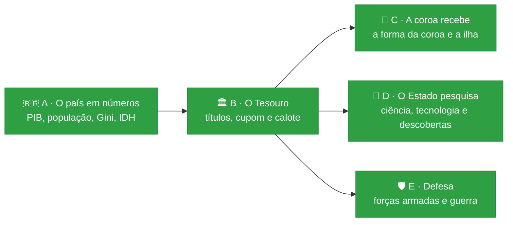

# 🎲 Trajetória

[](https://github.com/Lhordriyon/Calculadora-Viva/actions/workflows/ci.yml)
[](https://github.com/Lhordriyon/Calculadora-Viva/actions/workflows/android.yml)


## 📱 [Baixar o app para Android (APK)](https://github.com/Lhordriyon/Calculadora-Viva/releases/download/android/Trajetoria.apk)

## 🌐 [Jogar no navegador](https://lhordriyon.github.io/Calculadora-Viva/)

**Instalar no Android:** toque no link acima pelo celular, abra o arquivo `Trajetoria.apk` quando o download terminar e confirme. Se o Android pedir, permita que o navegador instale apps ("fontes desconhecidas"). Para atualizar, baixe de novo e instale por cima: a vida salva continua. O APK é gerado de novo a cada atualização do jogo ([página da versão](https://github.com/Lhordriyon/Calculadora-Viva/releases/tag/android)).

---

## 🆕 Novidades: Bloco F · O poder que passa (26/10/2026)

> [!IMPORTANT]
> **O que mudou:** a coroa, o Regime e a ilha agora passam de verdade. Quem continua a história herda o trono, seja quem for: o filho, o par, o amigo ou o sobrinho. A resposta vem no primeiro ano da vida nova, ou aos 18 (até lá, a regência governa). E vem também quando o pai ou a mãe que reinava morre durante a sua vida. Enquanto você pensa, o governo espera: ninguém toma o seu lugar no meio do caminho.
>
> E o poder também se toma. Na folha Carreira e poder, a seção nova "Tomar o poder" mostra o que não passa pela urna:
> - ficar no poder: quem é presidente fecha o Congresso (uma aposta na popularidade) ou muda a Constituição para mais quatro anos (uma aposta na influência);
> - tomar o poder: quem tem influência lidera os quartéis (se for coronel ou general) ou financia os generais (R$ 20 bilhões);
> - restaurar a monarquia: quem é famoso e rico banca o plebiscito e, se o povo quiser, é coroado.
>
> Dá certo: o cargo para a vida inteira, e quem herda entra na fila. Dá errado: o impeachment ou a cadeia. Lá fora, o mundo reage: a Federação do Norte esfria, a República Celeste se aproxima, e a sanção que vier aponta o golpe.

> [!TIP]
> **Para testar:**
> - Comece na família real ("Nova vida", linhagem). Quando o pai ou a mãe que reina morrer, o Palácio espera a sua resposta: aceitar, abdicar ou propor o fim da monarquia. Com menos de 18, a regência governa, e a resposta vem no seu aniversário.
> - Reine e morra com alguém para continuar (o filho ou, pelo testamento, o par ou o amigo): a vida nova começa na fila, e a coroa chega no primeiro ano.
> - Chegue a presidente e abra "Tomar o poder" na folha Carreira e poder. Com a popularidade alta, o autogolpe tende a dar certo; depois, o país vira Regime, não há mais eleição geral e você governa até morrer.
> - Funde um país sendo presidente: você deixa o cargo daqui na hora, e quem assume o governo aponta a fundação como causa.
> - Salve o país da crise comprando títulos: os R$ 200 bilhões viram um título do Tesouro, que paga juro todo ano (e pode levar calote).

| ✅ O que este bloco trouxe | ⏳ O que ele ainda não trouxe |
|---|---|
| 👑 **A sucessão que passa:** a coroa, o Regime e a ilha vão para quem herda, seja quem for, no primeiro ano ou aos 18, e também quando quem reina morre em vida | 🏝️ **Governar a ilha e a cidade que você fundou** (o imposto e as obras pagas do próprio bolso): é o próximo bloco, o F2 |
| 🏛️ **Sem interregno:** enquanto você responde, quem governava continua; quem abdica devolve o governo no ano seguinte | 🏦 **O empréstimo aos bancos como contrato** e os bens que rendem: o bloco I |
| ⚔️ **Tomar o poder:** o autogolpe, o golpe (pelos quartéis ou pelo dinheiro) e a coroa restaurada no plebiscito, com o teste e o preço à vista | 🌍 **Países de verdade e o mapa:** precisam de uma decisão sua (hoje a política do jogo é toda fictícia) |
| 🌐 **O mundo reage ao golpe:** sob o Regime, a Federação esfria e a Celeste se aproxima, e a sanção aponta o golpe | |
| 🏝️ **Quem vai reinar na ilha deixa o Brasil:** o cargo daqui acaba na hora, e o governo de transição aponta a fundação | |
| 💼 **Quem tem cargo vive dele:** não é demitido, e a coroa leva a carreira de antes; sob o Regime, não há eleição geral | |
| 💰 **O resgate do país vira título:** os R$ 200 bilhões entram no patrimônio, pagam cupom e podem levar calote | |

No túnel de vento, todas as 516 sucessões que chegaram a um adulto tiveram resposta (404 em vida, 112 na herança), e 79% de quem começou a vida na fila reinou. Os anos em que quem joga governa o país quase dobraram (de 6.742 para 12.587 nas 10.000 vidas). Das 69 tentativas de golpe e autogolpe, 68% deram certo; das 40 de restaurar a monarquia, 30%. Nenhuma estratégia passou a vencer em tudo, e a CPU não mudou. Os outros pedidos da lista de 26/10 (as empresas com caixa e pesquisa, os filhos quando quiser, a vida longa, os impostos, a escola inteira, os gráficos) estão em ordem logo abaixo. O histórico está no [📜 CHANGELOG](CHANGELOG.md), com o bloco anterior (a defesa).

## 🗺️ Os blocos do dono

Pedidos do dono em 19/10, em blocos pequenos, na ordem em que um precisa do outro. A cara nova (V1) e a correção dela (C1 a C3) entraram no meio, a pedido dele. Os cinco estão feitos; seguem o bloco B2 (o título comprado pela empresa e o orçamento do governo item por item) e a identidade das pessoas (o ex que continua existindo):



| Bloco | O que entra | Por que nesta ordem |
|---|---|---|
| 🟢 **A** · O país em números | PIB, população, PIB per capita, Gini, IDH | ✅ feito |
| 🟢 **B** · O Tesouro | o título do Tesouro com cupom, vencimento e calote; a dívida pública em reais | ✅ feito (o título da empresa espera o caixa dela, I-11) |
| 🟢 **C** · A coroa recebe | o salário, a parte dos impostos ou a taxa da coroa; a ilha com população, PIB e imposto | ✅ feito |
| 🟢 **D** · O Estado pesquisa | a ciência paga pelo Tesouro, a tecnologia do país e as descobertas (a cura, o satélite, a patente) | ✅ feito |
| 🟢 **E** · Defesa | forças armadas com custo e capacidade; os sistemas de armamento; a guerra como processo, com custos e consequências | ✅ feito (a ocupação e as alianças militares ficam para depois) |

### A segunda lista do dono (26/10)

A lista nova não cabe de uma vez. A ordem começa pelos defeitos (o que já existe e não funciona) e segue pelo que mais muda o que dá para fazer numa vida, um bloco publicado de cada vez. As ideias de cada um estão em [`docs/ideias.md`](docs/ideias.md) (a seção "A segunda ordem do dono").

```mermaid
flowchart LR
  F["👑 F · O poder que passa<br/>sucessão, golpe, governo vitalício"]:::feito --> F2["🏝️ F2 · Governar o que você fundou<br/>a ilha e a cidade"]:::proximo
  F2 --> C4["✍️ C4 · O texto revisado"]:::depois
  C4 --> K["👶 K · Filhos quando quiser"]:::depois
  K --> I["💰 I · O dinheiro que rende"]:::depois
  I --> H["🏭 H · A empresa de verdade"]:::depois
  H --> J["🧬 J · A vida longa"]:::depois
  classDef feito fill:#2ea043,stroke:#1a7f37,color:#fff
  classDef proximo fill:#bf8700,stroke:#9a6700,color:#fff
  classDef depois fill:#8250df,stroke:#6639ba,color:#fff
```



| Bloco | O que entra | Estado |
|---|---|---|
| 🟢 **F** · O poder que passa | a sucessão da coroa, do Regime e da ilha para quem herda (com a regência); o golpe, o autogolpe e a coroa restaurada; quem vai reinar na ilha deixa o Brasil; o resgate do país como título | ✅ feito |
| 🟡 **F2** · Governar o que você fundou | a ilha e a cidade como territórios, com imposto e obras pagas do próprio bolso | ⏭️ próximo |
| 🟣 **C4** · O texto revisado | a varredura de gramática do conteúdo inteiro, com regras novas no validador | depois |
| 🟣 **K** · Filhos quando quiser | tentar ter filho, adotar e planejar, com a fertilidade pela idade | depois |
| 🟣 **I** · O dinheiro que rende | os bens que produzem, a carteira de dívidas do SPC e do Serasa como ativo, o empréstimo aos bancos como contrato | depois |
| 🟣 **H** · A empresa de verdade | o caixa da empresa, o lucro com origem, a pesquisa e desenvolvimento, as fábricas e lojas | depois |
| 🟣 **J** · A vida longa | a ciência da longevidade, com etapas até a reversão do envelhecimento e a continuidade do eu | depois |
| 🟣 **G**, **L**, **M**, **P**, **N** | os impostos um por um; a escola inteira e mais profissões; a civilização; os gráficos; as formas de governo | depois |
| ⚪ **O** · O mundo | o mapa-múndi e os países de verdade | pede a sua decisão: hoje governos, partidos e países são fictícios por requisito seu |

## 🎮 O que o jogo tem

<details open>
<summary><b>👶 A vida</b></summary>

- Nascer numa cidade brasileira, em 8 classes sociais (do barraco ao trilionário), 4 tipos de família e 9 linhagens (família real, Regime, futebol, circo, agro, políticos…), ou criar o personagem escolhendo tudo
- Primeira infância com causa e efeito: o que acontece até os 4 anos volta dos 5 aos 12
- ENEM, curso, 49 profissões com cargos e promoção, concurso, aposentadoria
- Família viva: mãe, pai, avó, amigo, amor e até quatro filhos, cada um com saúde, dinheiro, jeito e vínculo, que envelhecem, adoecem, ajudam ou atrapalham
- Fichas de ação por ano: estudar, trabalhar, cuidar da saúde, ver a família, sair, poupar
</details>

<details>
<summary><b>💸 O dinheiro</b></summary>

- Carteira em cinco classes (renda fixa, ações, fundos imobiliários, dólar, cripto), três perfis de investidor e o padrão de vida escolhido
- Toda dívida é um contrato com o banco: cheque especial, empréstimo, financiamento com garantia e acordo. Atrasar suja o nome, e o imóvel financiado vai a leilão
- Emprestar ao governo: o título do Tesouro paga cupom todo ano, vence ou é vendido pelo preço do dia, e o calote leva parte dele
- 30 bens: morar, alugar, financiar, imóveis de renda, carros, iate, jatinho, emissora de TV
- Até cinco empresas, com subsidiárias, fusões, bolsa e a mesa de quem manda
- Brincar de deus: 14 jogadas bilionárias, de uma estátua a uma colônia em Marte, e a ilha que vira país, com população, PIB e coroa
- Todo real tem contraparte: o extrato do ano e o da vida fecham entrada por entrada
</details>

<details>
<summary><b>🏛️ O país e o mundo</b></summary>

- O país vivo: crescimento, desemprego, inflação, juros, dívida, pobreza, violência, saúde e educação públicas, tecnologia, aprovação, PIB, população, PIB per capita, Gini, IDH e a dívida pública em reais
- A ciência paga pelo Tesouro: a tecnologia do país vira crescimento, saúde e empresas, e descoberta (a cura, o satélite, a patente)
- As Forças Armadas com custo e capacidade, os sistemas de armamento e a guerra como processo: ela começa com quem sanciona e anda frio, custa todo ano e acaba em vitória, derrota ou cessar-fogo
- Quatro blocos políticos fictícios e o Regime; eleições a cada quatro anos; o seu voto pesa
- Ser vereador, prefeito, deputado, governador, senador, presidente, monarca ou chefe do Regime; quem governa muda as políticas do país
- A coroa, o Regime e a ilha passam a quem herda (com a regência até os 18); o poder também se toma: o autogolpe, o golpe e a coroa restaurada no plebiscito
- Quatro países fictícios lá fora, com o dólar, sanções, acordos e atos de quem governa
</details>

<details>
<summary><b>🏰 A dinastia</b></summary>

- Ao morrer, o cartão mostra os três pontos de virada da vida, para compartilhar
- A história continua com quem herda: filho, sobrinho, o par ou um amigo, pelo testamento escolhido em vida
- Sem testamento, os filhos dividem a herança
</details>

## 🚧 O que o jogo ainda não tem

- 🏢 O título do Tesouro comprado pela empresa (precisa do caixa da empresa) e o orçamento do governo item por item
- ⚖️ A legitimidade de quem governa medida à parte da popularidade
- 🛡️ A ocupação de território, as alianças militares e a guerra entre os países de fora
- 💔 O ex que continua existindo depois do fim do namoro, e as relações entre os personagens (a mãe com o pai, o amigo com o par)
- 💬 Conversar com as pessoas com as suas palavras
- ✈️ Morar em outro país
- 🚔 Crime com consequência
- 🗺️ Setores da economia por estado

Todas as ideias, com o que cada uma precisa antes, estão em [`docs/ideias.md`](docs/ideias.md). A ordem está em [`docs/roteiro.md`](docs/roteiro.md).

---

## 📖 Sobre o jogo

Uma vida inteira em poucos minutos, no celular. Você nasce numa cidade brasileira (ou num palácio, num Brasil onde a monarquia venceu o plebiscito), aperta **+1 ano** e responde ao que a vida joga na sua frente: ENEM, primeiro emprego, cartão de crédito, concurso, Pix suspeito, aposentadoria. A cada ano você escolhe o que fazer, tenta a profissão que quiser, compra imóveis, carros, iate ou uma emissora de TV, abre empresa e compra concorrentes, disputa eleições e escolhe quem herda tudo. Cada escolha deixa uma marca, e algumas voltam décadas depois. Ao morrer, o jogo mostra os três pontos de virada da sua vida num cartão que dá para compartilhar, e a história pode continuar com quem herdou.

## 🛠️ Rodar

Precisa de Node 22.18 ou mais novo.

```sh
npm install
npm run dev        # jogo em http://localhost:5173
npm run verificar  # tipos, testes, validador de conteúdo, túnel de vento e build
```

Outros comandos: `npm run validar` (só o conteúdo), `npm run tunel` (10.000 vidas simuladas → `docs/metricas.md`), `npm run vida -- 42 aleatoria` (imprime uma vida inteira jogada por um robô) e `npm run telas -- URL` (a régua da tela: 52 critérios de interface em sete tamanhos de tela e letra, contra a build no ar).

Para escrever eventos, veja [`docs/conteudo.md`](docs/conteudo.md). O método de trabalho e as regras do projeto estão em [`CLAUDE.md`](CLAUDE.md).
