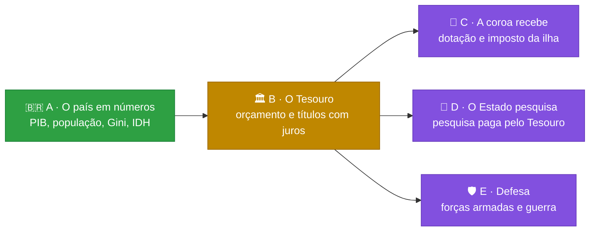

# 🎲 Trajetória

[](https://github.com/Lhordriyon/Calculadora-Viva/actions/workflows/ci.yml)
[](https://github.com/Lhordriyon/Calculadora-Viva/actions/workflows/android.yml)


## 📱 [Baixar o app para Android (APK)](https://github.com/Lhordriyon/Calculadora-Viva/releases/download/android/Trajetoria.apk)

## 🌐 [Jogar no navegador](https://lhordriyon.github.io/Calculadora-Viva/)

**Instalar no Android:** toque no link acima pelo celular, abra o arquivo `Trajetoria.apk` quando o download terminar e confirme. Se o Android pedir, permita que o navegador instale apps ("fontes desconhecidas"). Para atualizar, baixe de novo e instale por cima: a vida salva continua. O APK é gerado de novo a cada atualização do jogo ([página da versão](https://github.com/Lhordriyon/Calculadora-Viva/releases/tag/android)).

---

## 🆕 Novidades: Bloco R · As pessoas da sua vida (25/10/2026)

> [!IMPORTANT]
> **O que mudou:** cada pessoa da sua vida passou a ter uma relação de verdade com você: a mãe, o pai, a avó, o amigo, o par e cada filho.
> - Ela guarda mágoa, confia ou desconfia, sente saudade e lembra da melhor e da pior coisa que você fez com ela.
> - Ela tem uma opinião sobre você, com o porquê ("Acha você generosa, mas sumida").
> - Ela quer coisas da vida, cobra, desiste e age pelo que sabe de você.
> - Quando ela morre, a morte conta o que foi a relação e o que faltou.

> [!TIP]
> **Para testar:** jogue duas vidas.
> 1. Na primeira, cuide das pessoas. Abra a folha **Família**, toque **Fazer algo com…** e converse, dê o presente certo, peça desculpas. Quando sua mãe disser que nunca viu o mar, leve ela.
> 2. Na segunda, suma: não visite ninguém, peça dinheiro e não devolva.
>
> Depois compare o que a folha Família diz de você, quem aparece no seu aniversário de 70 anos e o texto das mortes.

| ✅ O que este bloco trouxe | ⏳ O que ele ainda não trouxe |
|---|---|
| 💞 **Relação de verdade com cada pessoa:** afeto, confiança, mágoa e anos sem contato. A mágoa passa no ritmo de cada um (o generoso perdoa mais rápido que o rígido). Magoada, a pessoa briga mais e ajuda menos; com mágoa demais, rompe, e o par faz as malas | 🧠 **Consciência de verdade:** as pessoas seguem regras e textos escritos; elas não pensam nem conversam livremente. O jogo não tem servidor nem texto gerado. O que existe é o comportamento de quem conhece você: a opinião, a memória, as vontades e a reação |
| 🪞 **O que cada um acha de você:** são 14 opiniões, de "um orgulho", "carinhoso" e "de palavra" a "sumido", "metido", "interesseiro" e "cabeça-quente". Elas saem do que a pessoa viu você fazer, do que todo mundo sabe (formatura, fama, fortuna) e do que só quem está perto sabe (o nome sujo), e cada uma mostra o porquê | 💬 Conversar com as pessoas com as suas palavras |
| 🫥 **O que você deixou de fazer:** quem passa um ano doente sem ver você guarda a falta, e ela vira a pior lembrança ("de quando você não apareceu quando ela estava doente, aos 41") | 👥 As relações entre os personagens (a mãe com o pai, o amigo com o par) e o ex que continua existindo |
| 🌊 **Vontades:** ver o mar, voltar à terra natal, ver o neto de perto, casar, ter um filho, um bicho, a entrada da casa, a viagem com o amigo e a festa de 80 anos. Realizar é uma escolha com a pessoa. A vontade que espera vira cobrança, e a que passa da hora vira falta | ⚙️ **Correção C3**, regras que se medem errado: a régua do dinheiro, os falsos dilemas, os mandatos sem fim, a herdeira |
| 🕯️ **A morte conta a relação:** quem morre magoado, longe ou com uma vontade guardada deixa remorso. Quem estava perto e em paz deixa a despedida. E a morte diz o que faltou ("Ela nunca viu o mar.") | 📱 O ícone novo no app Android instalado |
| 👴 **Os filhos aprendem com você:** na sua velhice, quem foi presente é cuidado. Quem sumiu recebe um "parabéns, muita saúde" às 23h47 | |
| 🤝 **Fazer algo com cada pessoa:** a folha Família abre as ações com cada um, e cada ação gasta uma escolha do ano. Dá para conversar de verdade, dar o presente certo pelo gosto dela, pedir desculpas, pedir um Pix e realizar a vontade dela | |

Em 200 vidas jogadas pelos robôs, quem cuida das pessoas (o robô cauteloso) se despede de alguém em todas as vidas e sente remorso em 8% delas. Quem negligencia (o robô arriscado) sente remorso em 60%, e em 56% alguém morre com uma vontade guardada. O túnel de vento joga as 10.000 vidas com as metas cumpridas. O histórico está no [📜 CHANGELOG](CHANGELOG.md).

## 🗺️ Os próximos blocos

Pedidos do dono em 19/10, em blocos pequenos, na ordem em que um precisa do outro. A cara nova (V1) e a correção dela (C1 a C3) entraram no meio, a pedido dele:



| Bloco | O que entra | Por que nesta ordem |
|---|---|---|
| 🟢 **A** · O país em números | PIB, população, PIB per capita, Gini, IDH | ✅ feito |
| 🟡 **B** · O Tesouro | o orçamento do governo em reais; comprar títulos que pagam cupom na conta ou no caixa da empresa | quem paga a coroa, a pesquisa e o exército é o Tesouro |
| 🟣 **C** · A coroa recebe | dotação da Casa Real que sai do Tesouro; a ilha soberana com população, PIB e imposto | precisa do Tesouro (B) e do país em números (A) |
| 🟣 **D** · O Estado pesquisa | quem governa decide quanto do orçamento vai para P&D; a pesquisa vira cura, satélite, patente | precisa do orçamento (B) |
| 🟣 **E** · Defesa | forças armadas com custo e capacidade; guerra como processo, com custos e consequências | precisa do orçamento (B) e do mundo lá fora (já feito) |

## 🎮 O que o jogo tem

<details open>
<summary><b>👶 A vida</b></summary>

- Nascer numa cidade brasileira, em 8 classes sociais (do barraco ao trilionário), 4 tipos de família e 9 linhagens (família real, Regime, futebol, circo, agro, políticos…), ou criar o personagem escolhendo tudo
- Primeira infância com causa e efeito: o que acontece até os 4 anos volta dos 5 aos 12
- ENEM, curso, 49 profissões com cargos e promoção, concurso, aposentadoria
- Família viva: mãe, pai, avó, amigo, amor e até quatro filhos, cada um com saúde, dinheiro, jeito e vínculo, que envelhecem, adoecem, ajudam ou atrapalham
- Fichas de ação por ano: estudar, trabalhar, cuidar da saúde, ver a família, sair, poupar
</details>

<details>
<summary><b>💸 O dinheiro</b></summary>

- Carteira em cinco classes (renda fixa, ações, fundos imobiliários, dólar, cripto), três perfis de investidor e o padrão de vida escolhido
- Toda dívida é um contrato com o banco: cheque especial, empréstimo, financiamento com garantia e acordo. Atrasar suja o nome, e o imóvel financiado vai a leilão
- 30 bens: morar, alugar, financiar, imóveis de renda, carros, iate, jatinho, emissora de TV
- Até cinco empresas, com subsidiárias, fusões, bolsa e a mesa de quem manda
- Brincar de deus: 14 jogadas bilionárias, de uma estátua a uma colônia em Marte
- Todo real tem contraparte: o extrato do ano e o da vida fecham entrada por entrada
</details>

<details>
<summary><b>🏛️ O país e o mundo</b></summary>

- O país vivo: crescimento, desemprego, inflação, juros, dívida, pobreza, violência, saúde e educação públicas, aprovação, e agora PIB, população, PIB per capita, Gini e IDH
- Quatro blocos políticos fictícios e o Regime; eleições a cada quatro anos; o seu voto pesa
- Ser vereador, prefeito, deputado, governador, senador, presidente, monarca ou chefe do Regime; quem governa muda as políticas do país
- Quatro países fictícios lá fora, com o dólar, sanções, acordos e atos de quem governa
</details>

<details>
<summary><b>🏰 A dinastia</b></summary>

- Ao morrer, o cartão mostra os três pontos de virada da vida, para compartilhar
- A história continua com quem herda: filho, sobrinho, o par ou um amigo, pelo testamento escolhido em vida
- Sem testamento, os filhos dividem a herança
</details>

## 🚧 O que o jogo ainda não tem

- 🏛️ Tesouro com orçamento em reais e títulos públicos (bloco B)
- 👑 Renda para quem é soberano de uma ilha, e a coroa paga pelo Estado (bloco C)
- 🔬 Pesquisa e desenvolvimento pagos pelo Estado (bloco D)
- 🛡️ Forças armadas e guerra (bloco E)
- 💔 O ex que continua existindo depois do fim do namoro, e as relações entre os personagens (a mãe com o pai, o amigo com o par)
- 💬 Conversar com as pessoas com as suas palavras
- ✈️ Morar em outro país
- 🚔 Crime com consequência
- 🗺️ Setores da economia por estado

Todas as ideias, com o que cada uma precisa antes, estão em [`docs/ideias.md`](docs/ideias.md). A ordem está em [`docs/roteiro.md`](docs/roteiro.md).

---

## 📖 Sobre o jogo

Uma vida inteira em poucos minutos, no celular. Você nasce numa cidade brasileira (ou num palácio, num Brasil onde a monarquia venceu o plebiscito), aperta **+1 ano** e responde ao que a vida joga na sua frente: ENEM, primeiro emprego, cartão de crédito, concurso, Pix suspeito, aposentadoria. A cada ano você escolhe o que fazer, tenta a profissão que quiser, compra imóveis, carros, iate ou uma emissora de TV, abre empresa e compra concorrentes, disputa eleições e escolhe quem herda tudo. Cada escolha deixa uma marca, e algumas voltam décadas depois. Ao morrer, o jogo mostra os três pontos de virada da sua vida num cartão que dá para compartilhar, e a história pode continuar com quem herdou.

## 🛠️ Rodar

Precisa de Node 22.18 ou mais novo.

```sh
npm install
npm run dev        # jogo em http://localhost:5173
npm run verificar  # tipos, testes, validador de conteúdo, túnel de vento e build
```

Outros comandos: `npm run validar` (só o conteúdo), `npm run tunel` (10.000 vidas simuladas → `docs/metricas.md`), `npm run vida -- 42 aleatoria` (imprime uma vida inteira jogada por um robô) e `npm run telas -- URL` (a régua da tela: 52 critérios de interface em sete tamanhos de tela e letra, contra a build no ar).

Para escrever eventos, veja [`docs/conteudo.md`](docs/conteudo.md). O método de trabalho e as regras do projeto estão em [`CLAUDE.md`](CLAUDE.md).
