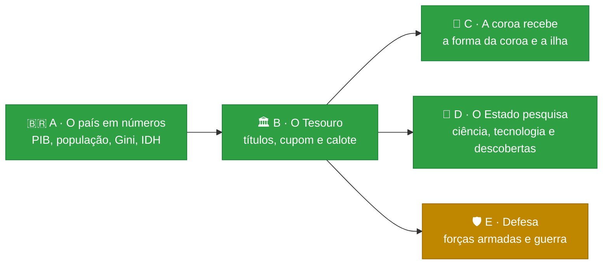

# 🎲 Trajetória

[](https://github.com/Lhordriyon/Calculadora-Viva/actions/workflows/ci.yml)
[](https://github.com/Lhordriyon/Calculadora-Viva/actions/workflows/android.yml)


## 📱 [Baixar o app para Android (APK)](https://github.com/Lhordriyon/Calculadora-Viva/releases/download/android/Trajetoria.apk)

## 🌐 [Jogar no navegador](https://lhordriyon.github.io/Calculadora-Viva/)

**Instalar no Android:** toque no link acima pelo celular, abra o arquivo `Trajetoria.apk` quando o download terminar e confirme. Se o Android pedir, permita que o navegador instale apps ("fontes desconhecidas"). Para atualizar, baixe de novo e instale por cima: a vida salva continua. O APK é gerado de novo a cada atualização do jogo ([página da versão](https://github.com/Lhordriyon/Calculadora-Viva/releases/tag/android)).

---

## 🆕 Novidades: Bloco D · O Estado pesquisa (26/10/2026)

> [!IMPORTANT]
> **O que mudou:** quem governa decide quanto do orçamento vai para a ciência. A folha País ganhou a política "Ciência e tecnologia":
> - cortada, 0,3% do PIB;
> - regular, 0,5% do PIB;
> - prioridade, 0,9% do PIB.
>
> O dinheiro sai do Tesouro, e a dívida anda com ele. Em troca, a tecnologia do país sobe devagar e volta, uma década depois, como crescimento, saúde e empresas que crescem mais. Acima de um ponto, o país descobre coisas: a vacina feita aqui, o satélite e a patente que vira indústria. Com a ciência cortada, os cientistas vão embora.

> [!TIP]
> **Para testar:**
> - Abra a folha País: a tecnologia está em "Como está", e a pesquisa pública em reais, em "Em números". O voto decide, porque a frente popular põe a ciência como prioridade e o bloco liberal corta.
> - Chegue a presidente e ponha a ciência como prioridade (a reforma mostra o custo antes). Anos depois, a descoberta aponta a sua reforma como causa.
> - Entre na faculdade num governo que prioriza a ciência e pegue a bolsa de iniciação. Num governo que corta, a federal para.
> - Com a tecnologia alta, a vacina chega ao posto no ano seguinte à descoberta. Se você for criança, o satélite passa na TV da escola. Com R$ 50 mil na conta, dá para entrar de sócio na empresa da patente.

| ✅ O que este bloco trouxe | ⏳ O que ele ainda não trouxe |
|---|---|
| 🔬 **A ciência paga pelo Tesouro:** a sétima política da folha País, com o custo em pontos do PIB e em reais. Cada bloco tem o seu nível | 📊 **O orçamento do governo item por item** (bloco B2): a pesquisa entra no gasto em pontos do PIB, como a saúde e a escola |
| 📈 **A tecnologia do país:** um estoque de 0 a 100 que anda devagar com a ciência e com a escola. Ela volta como crescimento, saúde pública e tração das empresas (as de tecnologia mais; as de saúde, indústria e agro, menos) | 🏢 **A pesquisa das empresas:** a empresa ainda não tem caixa próprio (ideia I-11) |
| 💉 **As descobertas:** a cura, o satélite e a patente. Cada uma aponta a decisão que deixou a ciência como prioridade, mesmo se outro governo a desfez depois | 👩‍🔬 **Os cientistas como pessoas** e o setor privado do país (ideia I-36) |
| ✈️ **A fuga de cérebros:** com a ciência cortada e a tecnologia baixa, os laboratórios esvaziam, e o corte é a causa | 🌍 **A corrida tecnológica** com os países de fora |
| 🎓 **Oito histórias novas:** a bolsa de iniciação ou a greve da federal, o edital ou o laboratório que apaga a luz, a olimpíada do instituto, a vacina no posto, o satélite na TV e a empresa da patente | |
| 💼 **Quem é cientista sente a verba:** a vaga e a promoção valem metade com a ciência cortada e 1,6 vez com a prioridade | |
| 🚀 **As jogadas somam:** a cura paga por quem é bilionário e o foguete em órbita põem a tecnologia do país para cima | |

No túnel de vento, a tecnologia do país sobe 0,75 ponto por ano com a ciência como prioridade e cai 0,70 com ela cortada. 29% das vidas veem uma descoberta, e 91% delas apontam a decisão que pagou a ciência. O preço aparece na dívida: o calote foi de 1,1% para 1,9% das vidas. Nenhuma estratégia passou a vencer em tudo. O histórico está no [📜 CHANGELOG](CHANGELOG.md), com o bloco anterior (a coroa).

## 🗺️ Os próximos blocos

Pedidos do dono em 19/10, em blocos pequenos, na ordem em que um precisa do outro. A cara nova (V1) e a correção dela (C1 a C3) entraram no meio, a pedido dele:



| Bloco | O que entra | Por que nesta ordem |
|---|---|---|
| 🟢 **A** · O país em números | PIB, população, PIB per capita, Gini, IDH | ✅ feito |
| 🟢 **B** · O Tesouro | o título do Tesouro com cupom, vencimento e calote; a dívida pública em reais | ✅ feito (o título da empresa espera o caixa dela, I-11) |
| 🟢 **C** · A coroa recebe | o salário, a parte dos impostos ou a taxa da coroa; a ilha com população, PIB e imposto | ✅ feito |
| 🟢 **D** · O Estado pesquisa | a ciência paga pelo Tesouro, a tecnologia do país e as descobertas (a cura, o satélite, a patente) | ✅ feito |
| 🟡 **E** · Defesa | forças armadas com custo e capacidade; guerra como processo, com custos e consequências | precisa do orçamento (B) e do mundo lá fora (já feito) |

## 🎮 O que o jogo tem

<details open>
<summary><b>👶 A vida</b></summary>

- Nascer numa cidade brasileira, em 8 classes sociais (do barraco ao trilionário), 4 tipos de família e 9 linhagens (família real, Regime, futebol, circo, agro, políticos…), ou criar o personagem escolhendo tudo
- Primeira infância com causa e efeito: o que acontece até os 4 anos volta dos 5 aos 12
- ENEM, curso, 49 profissões com cargos e promoção, concurso, aposentadoria
- Família viva: mãe, pai, avó, amigo, amor e até quatro filhos, cada um com saúde, dinheiro, jeito e vínculo, que envelhecem, adoecem, ajudam ou atrapalham
- Fichas de ação por ano: estudar, trabalhar, cuidar da saúde, ver a família, sair, poupar
</details>

<details>
<summary><b>💸 O dinheiro</b></summary>

- Carteira em cinco classes (renda fixa, ações, fundos imobiliários, dólar, cripto), três perfis de investidor e o padrão de vida escolhido
- Toda dívida é um contrato com o banco: cheque especial, empréstimo, financiamento com garantia e acordo. Atrasar suja o nome, e o imóvel financiado vai a leilão
- Emprestar ao governo: o título do Tesouro paga cupom todo ano, vence ou é vendido pelo preço do dia, e o calote leva parte dele
- 30 bens: morar, alugar, financiar, imóveis de renda, carros, iate, jatinho, emissora de TV
- Até cinco empresas, com subsidiárias, fusões, bolsa e a mesa de quem manda
- Brincar de deus: 14 jogadas bilionárias, de uma estátua a uma colônia em Marte, e a ilha que vira país, com população, PIB e coroa
- Todo real tem contraparte: o extrato do ano e o da vida fecham entrada por entrada
</details>

<details>
<summary><b>🏛️ O país e o mundo</b></summary>

- O país vivo: crescimento, desemprego, inflação, juros, dívida, pobreza, violência, saúde e educação públicas, tecnologia, aprovação, PIB, população, PIB per capita, Gini, IDH e a dívida pública em reais
- A ciência paga pelo Tesouro: a tecnologia do país vira crescimento, saúde e empresas, e descoberta (a cura, o satélite, a patente)
- Quatro blocos políticos fictícios e o Regime; eleições a cada quatro anos; o seu voto pesa
- Ser vereador, prefeito, deputado, governador, senador, presidente, monarca ou chefe do Regime; quem governa muda as políticas do país
- Quatro países fictícios lá fora, com o dólar, sanções, acordos e atos de quem governa
</details>

<details>
<summary><b>🏰 A dinastia</b></summary>

- Ao morrer, o cartão mostra os três pontos de virada da vida, para compartilhar
- A história continua com quem herda: filho, sobrinho, o par ou um amigo, pelo testamento escolhido em vida
- Sem testamento, os filhos dividem a herança
</details>

## 🚧 O que o jogo ainda não tem

- 🏢 O título do Tesouro comprado pela empresa (precisa do caixa da empresa) e o orçamento do governo item por item
- ⚖️ A legitimidade de quem governa medida à parte da popularidade
- 🛡️ Forças armadas e guerra (bloco E)
- 💔 O ex que continua existindo depois do fim do namoro, e as relações entre os personagens (a mãe com o pai, o amigo com o par)
- 💬 Conversar com as pessoas com as suas palavras
- ✈️ Morar em outro país
- 🚔 Crime com consequência
- 🗺️ Setores da economia por estado

Todas as ideias, com o que cada uma precisa antes, estão em [`docs/ideias.md`](docs/ideias.md). A ordem está em [`docs/roteiro.md`](docs/roteiro.md).

---

## 📖 Sobre o jogo

Uma vida inteira em poucos minutos, no celular. Você nasce numa cidade brasileira (ou num palácio, num Brasil onde a monarquia venceu o plebiscito), aperta **+1 ano** e responde ao que a vida joga na sua frente: ENEM, primeiro emprego, cartão de crédito, concurso, Pix suspeito, aposentadoria. A cada ano você escolhe o que fazer, tenta a profissão que quiser, compra imóveis, carros, iate ou uma emissora de TV, abre empresa e compra concorrentes, disputa eleições e escolhe quem herda tudo. Cada escolha deixa uma marca, e algumas voltam décadas depois. Ao morrer, o jogo mostra os três pontos de virada da sua vida num cartão que dá para compartilhar, e a história pode continuar com quem herdou.

## 🛠️ Rodar

Precisa de Node 22.18 ou mais novo.

```sh
npm install
npm run dev        # jogo em http://localhost:5173
npm run verificar  # tipos, testes, validador de conteúdo, túnel de vento e build
```

Outros comandos: `npm run validar` (só o conteúdo), `npm run tunel` (10.000 vidas simuladas → `docs/metricas.md`), `npm run vida -- 42 aleatoria` (imprime uma vida inteira jogada por um robô) e `npm run telas -- URL` (a régua da tela: 52 critérios de interface em sete tamanhos de tela e letra, contra a build no ar).

Para escrever eventos, veja [`docs/conteudo.md`](docs/conteudo.md). O método de trabalho e as regras do projeto estão em [`CLAUDE.md`](CLAUDE.md).
