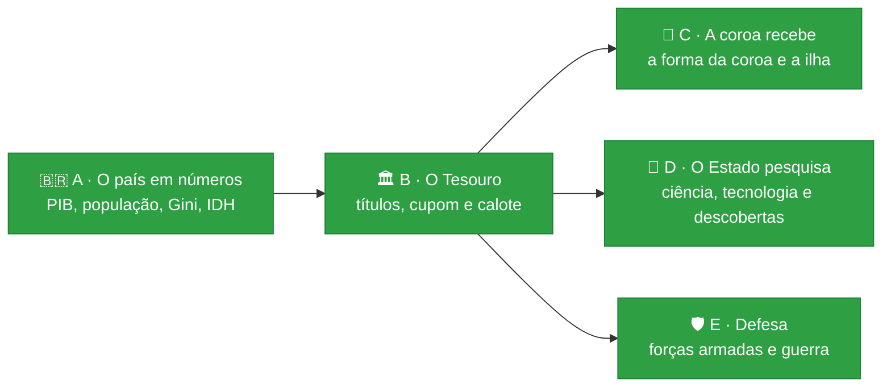

# 🎲 Trajetória

[](https://github.com/Lhordriyon/Calculadora-Viva/actions/workflows/ci.yml)
[](https://github.com/Lhordriyon/Calculadora-Viva/actions/workflows/android.yml)


## 📱 [Baixar o app para Android (APK)](https://github.com/Lhordriyon/Calculadora-Viva/releases/download/android/Trajetoria.apk)

## 🌐 [Jogar no navegador](https://lhordriyon.github.io/Calculadora-Viva/)

**Instalar no Android:** toque no link acima pelo celular, abra o arquivo `Trajetoria.apk` quando o download terminar e confirme. Se o Android pedir, permita que o navegador instale apps ("fontes desconhecidas"). Para atualizar, baixe de novo e instale por cima: a vida salva continua. O APK é gerado de novo a cada atualização do jogo ([página da versão](https://github.com/Lhordriyon/Calculadora-Viva/releases/tag/android)).

---

## 🆕 Novidades: Bloco E · Defesa (26/10/2026)

> [!IMPORTANT]
> **O que mudou:** o país ganhou Forças Armadas, e a guerra virou um processo com custo, não um botão. A folha País ganhou a política "Defesa":
> - desmobilizada: o governo gasta 0,3 ponto do PIB a menos, e os vizinhos relaxam;
> - regular;
> - reforçada: 0,5 ponto a mais, um pouco de voto e vizinhos preocupados.
>
> Quem governa encomenda caças, submarino, defesa antiaérea ou satélite militar: a conta vai para a dívida na hora, e o equipamento chega anos depois. A capacidade das Forças Armadas dissuade. Quando um país de fora já sanciona o Brasil e a relação está no chão, pode vir a guerra, e ela vem mais fácil para quem desarmou. Cada ano de guerra custa crescimento, inflação, dívida, gente e aprovação. Ela acaba em vitória, derrota ou cessar-fogo, e mais depressa se quem governa pedir a paz.

> [!TIP]
> **Para testar:**
> - Abra a folha País: a defesa está em "Como está", e a seção "Defesa" diz se há guerra à vista. O voto decide, porque a aliança da ordem reforça o quartel e a frente popular desmobiliza.
> - Chegue a presidente e rompa com um país que já anda frio. Se a sanção vier e o quartel estiver fraco, a guerra pode começar, e a notícia aponta o seu rompimento como causa (e a desmobilização, se você desarmou).
> - Em guerra, a folha mostra as chances de vitória, derrota e cessar-fogo pela capacidade daqui contra a força de lá. Peça a paz e veja o fim chegar mais rápido. Encomende caças e veja a entrega anos depois, com a encomenda de causa.
> - Tenha de 18 a 30 anos quando a guerra começar: chega a carta da convocação. Com um filho nessa idade, chega a dele. Nos anos de guerra, aparecem o racionamento, a fábrica de munição e o simulado de abrigo da escola.

| ✅ O que este bloco trouxe | ⏳ O que ele ainda não trouxe |
|---|---|
| 🛡️ **A política "Defesa":** a oitava da folha País, com o gasto, a relação lá fora e a aprovação de cada nível. Cada bloco tem o seu | 🗺️ **A ocupação e o território:** a guerra não move fronteira |
| 🎖️ **A capacidade das Forças Armadas:** de 0 a 100, anda devagar com a política e com a tecnologia do país (o armamento moderno vem da pesquisa) | 🏭 **A mobilização da economia** e a logística da guerra |
| ✈️ **Quatro sistemas de armamento:** caças, submarino, defesa antiaérea e satélite militar (que pede tecnologia). Um por ano, com o custo em reais e a entrega à vista | 🤝 **As alianças militares** e a guerra entre os países de fora (ideia I-51) |
| ⚔️ **A guerra como processo:** começa com quem sanciona e anda frio, apontando quem esfriou a relação e quem desarmou. Custa todo ano e acaba em vitória, derrota (com reparação) ou cessar-fogo; no oitavo ano, acaba de cansaço | 🏗️ **A reconstrução** como programa de governo |
| 🕊️ **O pedido de paz:** um por ano, de quem governa. Esquenta a relação e dobra a chance de a guerra acabar no ano seguinte | |
| 📖 **Oito histórias novas:** a convocação (servir, pedir dispensa ou sumir no interior), o filho convocado, o racionamento, a fábrica de munição, o simulado de abrigo, quem voltou, o desfile de Sete de Setembro e o quartel sem verba. Ninguém morre numa história de guerra | |
| 💼 **Quem é militar sente a verba:** a vaga e a promoção andam com a defesa | |

No túnel de vento, a guerra aparece em 2,9% das vidas, e 89% delas apontam a decisão que esfriou a relação. Nos anos de guerra, o país cresce −2,2% ao ano, contra 2,1% nos de paz. Com o quartel abaixo de 60, a guerra começa em 3,5% dos anos de ameaça; acima, em 2,9%. O preço do quartel reforçado aparece lá fora: as sanções foram de 3.406 para 5.165 nas 10.000 vidas. E a frente popular, que desmobiliza, gasta menos: o calote voltou de 1,9% para 1,1% das vidas. Nenhuma estratégia passou a vencer em tudo. O histórico está no [📜 CHANGELOG](CHANGELOG.md), com o bloco anterior (a ciência).

## 🗺️ Os blocos do dono

Pedidos do dono em 19/10, em blocos pequenos, na ordem em que um precisa do outro. A cara nova (V1) e a correção dela (C1 a C3) entraram no meio, a pedido dele. Os cinco estão feitos; seguem o bloco B2 (o título comprado pela empresa e o orçamento do governo item por item) e a identidade das pessoas (o ex que continua existindo):



| Bloco | O que entra | Por que nesta ordem |
|---|---|---|
| 🟢 **A** · O país em números | PIB, população, PIB per capita, Gini, IDH | ✅ feito |
| 🟢 **B** · O Tesouro | o título do Tesouro com cupom, vencimento e calote; a dívida pública em reais | ✅ feito (o título da empresa espera o caixa dela, I-11) |
| 🟢 **C** · A coroa recebe | o salário, a parte dos impostos ou a taxa da coroa; a ilha com população, PIB e imposto | ✅ feito |
| 🟢 **D** · O Estado pesquisa | a ciência paga pelo Tesouro, a tecnologia do país e as descobertas (a cura, o satélite, a patente) | ✅ feito |
| 🟢 **E** · Defesa | forças armadas com custo e capacidade; os sistemas de armamento; a guerra como processo, com custos e consequências | ✅ feito (a ocupação e as alianças militares ficam para depois) |

## 🎮 O que o jogo tem

<details open>
<summary><b>👶 A vida</b></summary>

- Nascer numa cidade brasileira, em 8 classes sociais (do barraco ao trilionário), 4 tipos de família e 9 linhagens (família real, Regime, futebol, circo, agro, políticos…), ou criar o personagem escolhendo tudo
- Primeira infância com causa e efeito: o que acontece até os 4 anos volta dos 5 aos 12
- ENEM, curso, 49 profissões com cargos e promoção, concurso, aposentadoria
- Família viva: mãe, pai, avó, amigo, amor e até quatro filhos, cada um com saúde, dinheiro, jeito e vínculo, que envelhecem, adoecem, ajudam ou atrapalham
- Fichas de ação por ano: estudar, trabalhar, cuidar da saúde, ver a família, sair, poupar
</details>

<details>
<summary><b>💸 O dinheiro</b></summary>

- Carteira em cinco classes (renda fixa, ações, fundos imobiliários, dólar, cripto), três perfis de investidor e o padrão de vida escolhido
- Toda dívida é um contrato com o banco: cheque especial, empréstimo, financiamento com garantia e acordo. Atrasar suja o nome, e o imóvel financiado vai a leilão
- Emprestar ao governo: o título do Tesouro paga cupom todo ano, vence ou é vendido pelo preço do dia, e o calote leva parte dele
- 30 bens: morar, alugar, financiar, imóveis de renda, carros, iate, jatinho, emissora de TV
- Até cinco empresas, com subsidiárias, fusões, bolsa e a mesa de quem manda
- Brincar de deus: 14 jogadas bilionárias, de uma estátua a uma colônia em Marte, e a ilha que vira país, com população, PIB e coroa
- Todo real tem contraparte: o extrato do ano e o da vida fecham entrada por entrada
</details>

<details>
<summary><b>🏛️ O país e o mundo</b></summary>

- O país vivo: crescimento, desemprego, inflação, juros, dívida, pobreza, violência, saúde e educação públicas, tecnologia, aprovação, PIB, população, PIB per capita, Gini, IDH e a dívida pública em reais
- A ciência paga pelo Tesouro: a tecnologia do país vira crescimento, saúde e empresas, e descoberta (a cura, o satélite, a patente)
- As Forças Armadas com custo e capacidade, os sistemas de armamento e a guerra como processo: ela começa com quem sanciona e anda frio, custa todo ano e acaba em vitória, derrota ou cessar-fogo
- Quatro blocos políticos fictícios e o Regime; eleições a cada quatro anos; o seu voto pesa
- Ser vereador, prefeito, deputado, governador, senador, presidente, monarca ou chefe do Regime; quem governa muda as políticas do país
- Quatro países fictícios lá fora, com o dólar, sanções, acordos e atos de quem governa
</details>

<details>
<summary><b>🏰 A dinastia</b></summary>

- Ao morrer, o cartão mostra os três pontos de virada da vida, para compartilhar
- A história continua com quem herda: filho, sobrinho, o par ou um amigo, pelo testamento escolhido em vida
- Sem testamento, os filhos dividem a herança
</details>

## 🚧 O que o jogo ainda não tem

- 🏢 O título do Tesouro comprado pela empresa (precisa do caixa da empresa) e o orçamento do governo item por item
- ⚖️ A legitimidade de quem governa medida à parte da popularidade
- 🛡️ A ocupação de território, as alianças militares e a guerra entre os países de fora
- 💔 O ex que continua existindo depois do fim do namoro, e as relações entre os personagens (a mãe com o pai, o amigo com o par)
- 💬 Conversar com as pessoas com as suas palavras
- ✈️ Morar em outro país
- 🚔 Crime com consequência
- 🗺️ Setores da economia por estado

Todas as ideias, com o que cada uma precisa antes, estão em [`docs/ideias.md`](docs/ideias.md). A ordem está em [`docs/roteiro.md`](docs/roteiro.md).

---

## 📖 Sobre o jogo

Uma vida inteira em poucos minutos, no celular. Você nasce numa cidade brasileira (ou num palácio, num Brasil onde a monarquia venceu o plebiscito), aperta **+1 ano** e responde ao que a vida joga na sua frente: ENEM, primeiro emprego, cartão de crédito, concurso, Pix suspeito, aposentadoria. A cada ano você escolhe o que fazer, tenta a profissão que quiser, compra imóveis, carros, iate ou uma emissora de TV, abre empresa e compra concorrentes, disputa eleições e escolhe quem herda tudo. Cada escolha deixa uma marca, e algumas voltam décadas depois. Ao morrer, o jogo mostra os três pontos de virada da sua vida num cartão que dá para compartilhar, e a história pode continuar com quem herdou.

## 🛠️ Rodar

Precisa de Node 22.18 ou mais novo.

```sh
npm install
npm run dev        # jogo em http://localhost:5173
npm run verificar  # tipos, testes, validador de conteúdo, túnel de vento e build
```

Outros comandos: `npm run validar` (só o conteúdo), `npm run tunel` (10.000 vidas simuladas → `docs/metricas.md`), `npm run vida -- 42 aleatoria` (imprime uma vida inteira jogada por um robô) e `npm run telas -- URL` (a régua da tela: 52 critérios de interface em sete tamanhos de tela e letra, contra a build no ar).

Para escrever eventos, veja [`docs/conteudo.md`](docs/conteudo.md). O método de trabalho e as regras do projeto estão em [`CLAUDE.md`](CLAUDE.md).
