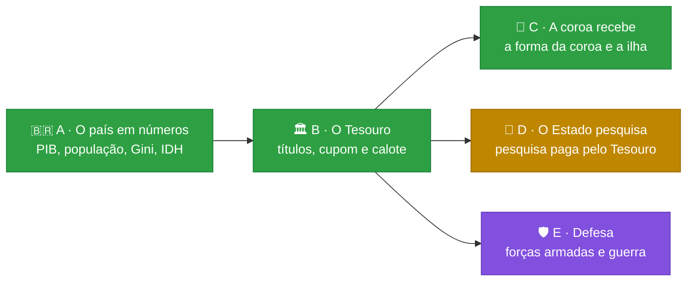

# 🎲 Trajetória

[](https://github.com/Lhordriyon/Calculadora-Viva/actions/workflows/ci.yml)
[](https://github.com/Lhordriyon/Calculadora-Viva/actions/workflows/android.yml)


## 📱 [Baixar o app para Android (APK)](https://github.com/Lhordriyon/Calculadora-Viva/releases/download/android/Trajetoria.apk)

## 🌐 [Jogar no navegador](https://lhordriyon.github.io/Calculadora-Viva/)

**Instalar no Android:** toque no link acima pelo celular, abra o arquivo `Trajetoria.apk` quando o download terminar e confirme. Se o Android pedir, permita que o navegador instale apps ("fontes desconhecidas"). Para atualizar, baixe de novo e instale por cima: a vida salva continua. O APK é gerado de novo a cada atualização do jogo ([página da versão](https://github.com/Lhordriyon/Calculadora-Viva/releases/tag/android)).

---

## 🆕 Novidades: Bloco C · A coroa recebe (26/10/2026)

> [!IMPORTANT]
> **O que mudou:** quem tem coroa escolhe como ela recebe. Vale para o monarca do Brasil e para quem é soberano da ilha que fundou:
> - o salário da Casa Real, fixo;
> - uma parte dos impostos, que sobe e desce com a economia;
> - a taxa da coroa, um imposto a mais só para ela.
>
> Cobrar mais custa aprovação, e abaixo de 30% o cargo balança. E a ilha que você funda virou um país de verdade, com população, PIB e imposto.

> [!TIP]
> **Para testar:**
> - Escolha a origem na linhagem da família real e aceite a coroa. Na folha Carreira e poder, troque o salário pela taxa da coroa: um a três anos depois, a rua enche de coroas de papelão rasgadas.
> - Fique rica o bastante para "Fundar um país" (em Brincar de deus). A ilha ganha o nome da sua cidade natal, 2.300 habitantes e PIB próprio. Com a taxa da coroa, o barco de mudança sai lotado.
> - Morra soberana com um filho: ele herda a ilha e a coroa dela, com a forma que você escolheu.

| ✅ O que este bloco trouxe | ⏳ O que ele ainda não trouxe |
|---|---|
| 👑 **Como a coroa recebe:** salário, parte dos impostos ou taxa da coroa, com a dotação e o custo de cada forma à vista antes de escolher. A forma muda uma vez por ano | ⚖️ **A legitimidade medida à parte da popularidade** (ideia I-42): ela mexe em todo o poder e fica para um bloco próprio |
| 💸 **A dotação é a renda de quem reina:** o Tesouro (no Brasil) ou a ilha paga, e ela é recalculada todo ano pela forma escolhida | 🏝️ **O imposto da ilha como decisão** (o paraíso fiscal) e as empresas que se mudam para lá |
| 📉 **O povo reage:** com a parte dos impostos, a aprovação anda 5 pontos para baixo; com a taxa, 15. Abaixo de 30%, o Brasil faz o plebiscito e a ilha entra em greve geral | 🎖️ **O ditador:** o Regime continua com o salário dele, porque não é coroa |
| 🏝️ **A ilha é um país:** tem nome ("Nova" mais a sua cidade natal), população, PIB e imposto de 20%, e anda todo ano. Reconhecida, cresce mais; com a taxa da coroa, esvazia | 🌐 **O reconhecimento como processo**, e a ilha nas relações com os países de fora |
| 👪 **A ilha passa a quem herda,** com a coroa e a forma escolhida | |
| 📖 **Quatro histórias novas, que chegam por causa da sua decisão:** a rua contra a taxa, a conta da parte dos impostos, a ilha que passou de 2.600 habitantes e o barco de mudança | |
| 🔧 **Três consertos:** a greve na ilha fala da população de agora e volta quando a aprovação cai. As propostas de emprego (a concorrente, o recrutador, o trabalho remoto em dólar) não chegam mais a quem tem cargo. As histórias de quem reina (a assinatura, as mordomias, o jubileu) aparecem num reinado comum; antes, quase nunca | |

No túnel de vento, 111 vidas tiveram coroa. Com a taxa, a coroa cai 2,2 vezes a cada 100 anos de reinado, contra 0,6 com o salário. A ilha de quem cobra a taxa por 5 anos ou mais termina com metade da gente: 1.413 habitantes, contra 2.791 sem a taxa. Nenhuma estratégia passou a vencer em tudo. O histórico está no [📜 CHANGELOG](CHANGELOG.md), com o bloco anterior (o Tesouro).

## 🗺️ Os próximos blocos

Pedidos do dono em 19/10, em blocos pequenos, na ordem em que um precisa do outro. A cara nova (V1) e a correção dela (C1 a C3) entraram no meio, a pedido dele:



| Bloco | O que entra | Por que nesta ordem |
|---|---|---|
| 🟢 **A** · O país em números | PIB, população, PIB per capita, Gini, IDH | ✅ feito |
| 🟢 **B** · O Tesouro | o título do Tesouro com cupom, vencimento e calote; a dívida pública em reais | ✅ feito (o título da empresa espera o caixa dela, I-11) |
| 🟢 **C** · A coroa recebe | o salário, a parte dos impostos ou a taxa da coroa; a ilha com população, PIB e imposto | ✅ feito |
| 🟡 **D** · O Estado pesquisa | quem governa decide quanto do orçamento vai para P&D; a pesquisa vira cura, satélite, patente | precisa do orçamento (B) |
| 🟣 **E** · Defesa | forças armadas com custo e capacidade; guerra como processo, com custos e consequências | precisa do orçamento (B) e do mundo lá fora (já feito) |

## 🎮 O que o jogo tem

<details open>
<summary><b>👶 A vida</b></summary>

- Nascer numa cidade brasileira, em 8 classes sociais (do barraco ao trilionário), 4 tipos de família e 9 linhagens (família real, Regime, futebol, circo, agro, políticos…), ou criar o personagem escolhendo tudo
- Primeira infância com causa e efeito: o que acontece até os 4 anos volta dos 5 aos 12
- ENEM, curso, 49 profissões com cargos e promoção, concurso, aposentadoria
- Família viva: mãe, pai, avó, amigo, amor e até quatro filhos, cada um com saúde, dinheiro, jeito e vínculo, que envelhecem, adoecem, ajudam ou atrapalham
- Fichas de ação por ano: estudar, trabalhar, cuidar da saúde, ver a família, sair, poupar
</details>

<details>
<summary><b>💸 O dinheiro</b></summary>

- Carteira em cinco classes (renda fixa, ações, fundos imobiliários, dólar, cripto), três perfis de investidor e o padrão de vida escolhido
- Toda dívida é um contrato com o banco: cheque especial, empréstimo, financiamento com garantia e acordo. Atrasar suja o nome, e o imóvel financiado vai a leilão
- Emprestar ao governo: o título do Tesouro paga cupom todo ano, vence ou é vendido pelo preço do dia, e o calote leva parte dele
- 30 bens: morar, alugar, financiar, imóveis de renda, carros, iate, jatinho, emissora de TV
- Até cinco empresas, com subsidiárias, fusões, bolsa e a mesa de quem manda
- Brincar de deus: 14 jogadas bilionárias, de uma estátua a uma colônia em Marte, e a ilha que vira país, com população, PIB e coroa
- Todo real tem contraparte: o extrato do ano e o da vida fecham entrada por entrada
</details>

<details>
<summary><b>🏛️ O país e o mundo</b></summary>

- O país vivo: crescimento, desemprego, inflação, juros, dívida, pobreza, violência, saúde e educação públicas, aprovação, PIB, população, PIB per capita, Gini, IDH e a dívida pública em reais
- Quatro blocos políticos fictícios e o Regime; eleições a cada quatro anos; o seu voto pesa
- Ser vereador, prefeito, deputado, governador, senador, presidente, monarca ou chefe do Regime; quem governa muda as políticas do país
- Quatro países fictícios lá fora, com o dólar, sanções, acordos e atos de quem governa
</details>

<details>
<summary><b>🏰 A dinastia</b></summary>

- Ao morrer, o cartão mostra os três pontos de virada da vida, para compartilhar
- A história continua com quem herda: filho, sobrinho, o par ou um amigo, pelo testamento escolhido em vida
- Sem testamento, os filhos dividem a herança
</details>

## 🚧 O que o jogo ainda não tem

- 🏢 O título do Tesouro comprado pela empresa (precisa do caixa da empresa) e o orçamento do governo item por item
- ⚖️ A legitimidade de quem governa medida à parte da popularidade
- 🔬 Pesquisa e desenvolvimento pagos pelo Estado (bloco D)
- 🛡️ Forças armadas e guerra (bloco E)
- 💔 O ex que continua existindo depois do fim do namoro, e as relações entre os personagens (a mãe com o pai, o amigo com o par)
- 💬 Conversar com as pessoas com as suas palavras
- ✈️ Morar em outro país
- 🚔 Crime com consequência
- 🗺️ Setores da economia por estado

Todas as ideias, com o que cada uma precisa antes, estão em [`docs/ideias.md`](docs/ideias.md). A ordem está em [`docs/roteiro.md`](docs/roteiro.md).

---

## 📖 Sobre o jogo

Uma vida inteira em poucos minutos, no celular. Você nasce numa cidade brasileira (ou num palácio, num Brasil onde a monarquia venceu o plebiscito), aperta **+1 ano** e responde ao que a vida joga na sua frente: ENEM, primeiro emprego, cartão de crédito, concurso, Pix suspeito, aposentadoria. A cada ano você escolhe o que fazer, tenta a profissão que quiser, compra imóveis, carros, iate ou uma emissora de TV, abre empresa e compra concorrentes, disputa eleições e escolhe quem herda tudo. Cada escolha deixa uma marca, e algumas voltam décadas depois. Ao morrer, o jogo mostra os três pontos de virada da sua vida num cartão que dá para compartilhar, e a história pode continuar com quem herdou.

## 🛠️ Rodar

Precisa de Node 22.18 ou mais novo.

```sh
npm install
npm run dev        # jogo em http://localhost:5173
npm run verificar  # tipos, testes, validador de conteúdo, túnel de vento e build
```

Outros comandos: `npm run validar` (só o conteúdo), `npm run tunel` (10.000 vidas simuladas → `docs/metricas.md`), `npm run vida -- 42 aleatoria` (imprime uma vida inteira jogada por um robô) e `npm run telas -- URL` (a régua da tela: 52 critérios de interface em sete tamanhos de tela e letra, contra a build no ar).

Para escrever eventos, veja [`docs/conteudo.md`](docs/conteudo.md). O método de trabalho e as regras do projeto estão em [`CLAUDE.md`](CLAUDE.md).
